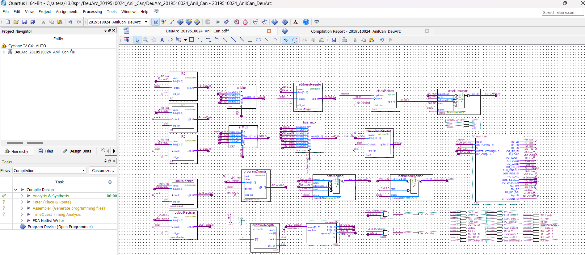
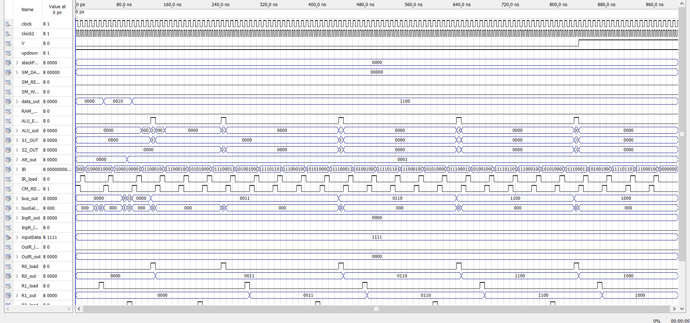
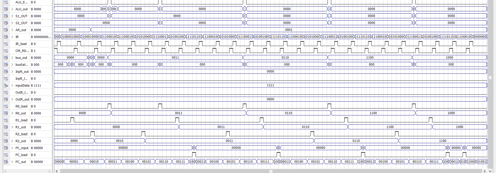

# ⚡ DeuArc: Custom 16-Bit Processor Architecture in VHDL

A custom multi-cycle processor architecture designed, synthesized, and simulated using **VHDL** and **Intel/Altera Quartus Prime**. 

`DeuArc` implements a proprietary Instruction Set Architecture (ISA), modular Arithmetic Logic Unit (ALU), hardwired Control Unit, and Harvard-style separated code/data memory structures.

---

## 🏛️ Architecture Overview

The processor comprises dedicated architectural submodules interconnected via structured internal buses:

- **Arithmetic Logic Unit (ALU):**
  - Modular arithmetic operations (`alu_add`, `ADDER`, increment units).
  - Bitwise operations and barrel shifter/multiplexers (`alu_shiftmux`).
  - Flag generation logic (Zero, Carry, Negative, Overflow).
- **Control Unit (`Control_Unit.bdf`):**
  - Multi-state finite state machine (FSM) generating execution control signals.
  - Instruction decoding logic with multi-cycle execution routing.
- **Memory & Storage:**
  - **Code Memory:** Dedicated instruction memory initialized via hex descriptors (`code_memory.hex`).
  - **Data Memory:** Read/write synchronous data storage (`dataMemory.vhd`, `data_memory.hex`).
  - **Register File:** Dedicated Program Counter (PC), Instruction Register (IR), Address Register (AR), and general-purpose registers.

---

## 📁 Repository Structure

```text
deu-arc-processor/
├── *.vhd                 # VHDL source modules (ALU, Registers, Memory, Datapath)
├── *.bdf                 # Top-level schematic block diagrams
├── *.hex                 # Memory initialization files
├── *.qsf / *.qpf         # Quartus Prime project configuration files
├── .gitignore
└── README.md
```

---

## 🛠️ Toolchain & Simulation

- **EDA Tool:** Intel / Altera Quartus II / Quartus Prime
- **Language:** VHDL (IEEE 1164 standard)
- **Target Platform:** Altera Cyclone IV / DE-series FPGA compatible synthesis

---

## 🚀 Getting Started

1. Open **Intel Quartus Prime**.
2. Select **File > Open Project** and choose `2019510024_AnilCan_DeuArc.qpf`.
3. Compile the design using **Processing > Start Compilation**.
4. Run functional/timing simulations using Quartus Simulation Tool or ModelSim.

## 📊 Schematics & Waveform Simulation

### Top-Level Architectural Schematic


### Simulation Timing & Waveforms

